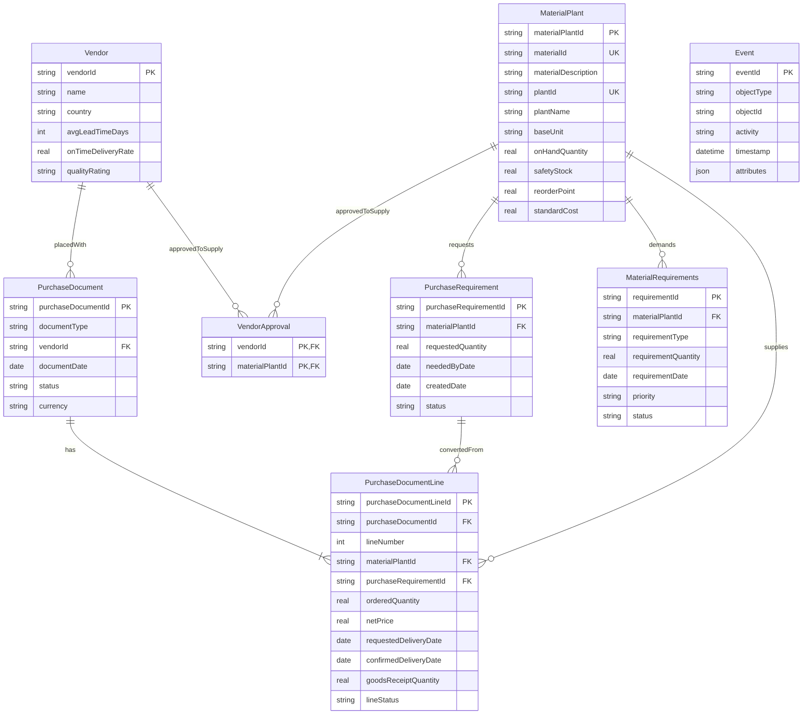

# Relational Data Model

The raw, relational truth that the semantic layer (`../context-model/`) is built on. It stores **only source facts** from [`../data/mock_data_schema.json`](../data/mock_data_schema.json). Derived values such as projected stock, shortfall, and spare stock are computed in code, never stored.

- **DDL:** [`schema.sql`](schema.sql) (SQLite)
- **Loader:** [`load_sqlite.py`](load_sqlite.py) builds `procurement.db` from the JSON and validates every reference.

```bash
python3 data-model/load_sqlite.py
```

## ERD



`Event` has no drawn relationship. Its `objectType` + `objectId` pair points to a different table per row, which a database foreign key can't express. The loader checks every reference instead.

## Source relationships → tables

| Source relationship | Cardinality | Implemented as |
|---|---|---|
| PurchaseDocumentLine → PurchaseDocument (`belongsTo`) | many-to-one | FK `PurchaseDocumentLine.purchaseDocumentId` |
| PurchaseDocumentLine → PurchaseRequirement (`convertedFrom`) | many-to-one | FK `PurchaseDocumentLine.purchaseRequirementId` |
| PurchaseDocumentLine → MaterialPlant (`supplies`) | many-to-one | FK `PurchaseDocumentLine.materialPlantId` |
| PurchaseDocument → Vendor (`placedWith`) | many-to-one | FK `PurchaseDocument.vendorId` |
| PurchaseRequirement → MaterialPlant (`requests`) | many-to-one | FK `PurchaseRequirement.materialPlantId` |
| MaterialRequirements → MaterialPlant (`demands`) | many-to-one | FK `MaterialRequirements.materialPlantId` |
| Vendor ↔ MaterialPlant (`approvedToSupply`) | many-to-many | Junction table `VendorApproval` (from `approvedForMaterials`) |
| Event → any object | many-to-one (generic) | `objectType` + `objectId`, validated by the loader |

## Design decisions

| Decision | Why |
|---|---|
| **MaterialPlant is the hub** | Inventory, demand, and supply all live at the material-plant grain. Risk is assessed per material-plant. |
| **`VendorApproval` junction table** | A relational table can't hold the `approvedForMaterials` array. "Approved supplier" is a customer rule, so it must be queryable. |
| **No MaterialRequirements ↔ PurchaseRequirement link** | Demand and supply are netted per material-plant, not matched one-to-one. Both join through MaterialPlant. |
| **Single generic `Event` table** | Every source event is recorded against exactly one object. Keeps the source's shape, and new object types need no schema change. |
| **Event `attributes` as JSON** | Payloads differ by activity (date change, goods receipt, none). Queryable with `json_extract`. |
| **No derived values stored** | Projected stock and shortfall change with every event; storing them would go stale. They're computed by the decision functions. |
| **Source names kept** | The semantic layer and the source JSON map to the tables one-to-one. |
| **CHECK constraints** | Allowed values for statuses and priorities, non-negative quantities, on-time rate 0–1, unique line number per PO. |

## Evolution path (not built)

Both are additive, so nothing built on the current tables breaks.

1. **Split `Material` and `Plant` out of `MaterialPlant`.** Removes repeated names and gives plant-level facts (location, transfer lead times between plants) a home. `MaterialPlant`'s primary key stays the same; `materialId` and `plantId` become foreign keys.
2. **`EventObject` link table.** If a source system records one event against several objects (e.g., one goods receipt closing several PO lines), move the event-to-object reference into its own table, as in the OCEL 2.0 object-centric event log standard.
